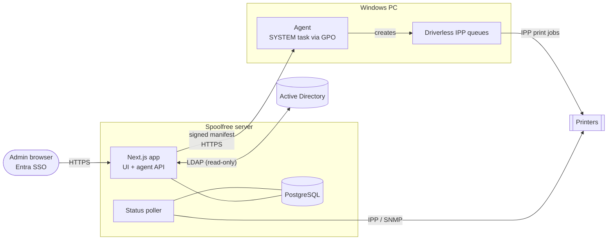

<div align="center">

# Spoolfree

**Driverless printer management for Windows Active Directory.**<br/>
No print server. No printer drivers. PrintNightmare-safe.

[](https://github.com/alee-ibrahim/spoolfree/actions/workflows/ci.yml)
[](LICENSE)
[](https://nextjs.org)
[](https://www.typescriptlang.org)
[](agent)
[](docs/agent.md)
[](CONTRIBUTING.md)

</div>

Spoolfree gives each Windows PC local, machine-wide **driverless IPP queues** that print straight to the printer through the inbox *Microsoft IPP Class Driver*. You pick which PCs get which printers by **AD OU**; a small PowerShell agent applies a **signed manifest** on each PC.

> **Status:** v0.4, usable for pilots. See [limitations](#limitations).

## Why

- **PrintNightmare** fixes made Point-and-Print driver installs admin-only, and many shops switched off spooler RPC to print servers.
- **Windows Protected Print Mode** (Windows 11 24H2) blocks third-party drivers completely.
- Most printers since ~2015 speak **IPP Everywhere / AirPrint / Mopria**, so Windows needs no vendor driver.
- What was missing is the management layer: *which PC gets which printer, which is default, is it out of toner?*

## Features

| | |
|---|---|
| **Entra ID login** | OIDC sign-in (automatic by default), limited to admins; optional break-glass local accounts. |
| **Printers** | Add, edit, delete, [bulk import/export](docs/deployment.md#bulk-import-and-export). **Test** checks driverless support over IPP; **Replace** swaps the device and keeps the name; default duplex; opt-in takeover of old queues. |
| **OU assignments** | Read-only LDAP(S) view of AD with inheritance, block rules, per-OU defaults and per-computer overrides. |
| **Preview** | "What will computer X get?", with a step-by-step trace and the exact manifest. |
| **Unassigned PCs** | Computers in `CN=Computers`, or whose OU chain gets no printers. |
| **Status dashboard** | IPP polling with SNMP fallback: online/offline, toner, jams, paper-out, page count; optional webhook alerts. |
| **Agents view** | Last check-in, applied printers and errors per PC; revoke a PC's token. |
| **Ops** | Audit log of every admin change, Prometheus `/metrics`, `/healthz`. |

## Screenshots

<table>
  <tr>
    <td width="50%"><br/><sub><b>Printers</b>: driverless check and replace</sub></td>
    <td width="50%"><br/><sub><b>Assignments</b>: printers by OU</sub></td>
  </tr>
  <tr>
    <td width="50%"><br/><sub><b>Status</b>: toner, jams, online state</sub></td>
    <td width="50%"><br/><sub><b>Agents</b>: per-PC check-ins and errors</sub></td>
  </tr>
</table>

<sub>Screenshots use the built-in development mode with sample data.</sub>

## Architecture



**How it works**

1. An admin assigns printers to OUs in the web UI.
2. At startup and every `AGENT_SYNC_INTERVAL_MINUTES` (default 15), each PC's agent requests its manifest with a per-machine token.
3. The server looks the PC up in AD by `objectGUID` (the OU always comes from AD, never the client), resolves inheritance and overrides, and signs the manifest with **Ed25519**.
4. The agent checks the signature against its pinned public key, the computer identity and the expiry.
5. It creates, re-points or removes the queues it owns, records the default printer, and reports back.

## Quick start

Development mode needs no AD or Entra. Requires Node.js 24.7+, pnpm and Docker.

```bash
pnpm install
docker compose up -d postgres          # PostgreSQL on 127.0.0.1:55432
cp .env.example .env                   # then set DEV_FAKE_AD=1, DEV_LOGIN=1, AUTH_SECRET
pnpm keygen --env >> .env              # signing key + enrollment token
pnpm seed:dev                          # sample printers, assignments and agents
pnpm dev:printers                      # (separate terminal) fake IPP printers on :8631-8635
pnpm dev                               # http://localhost:3000 -> "Development login"
```

`DEV_FAKE_AD=1` swaps LDAP for a built-in `example.org` directory; `DEV_LOGIN=1` skips Entra. **Production builds ignore both.**

## Deploy

**Server:** one non-root container (`docker build -t spoolfree .`) runs the UI, API and poller; migrations run at startup. For Kubernetes use the Helm chart in [`deploy/helm/spoolfree`](deploy/helm/spoolfree) with [`deploy/values.example.yaml`](deploy/values.example.yaml). Multiple replicas are safe.

**PCs (one GPO):**

1. Run `pnpm keygen`; store the signing key and enrollment token as secrets, keep the public key.
2. Copy `agent/*` to a share PCs can read, e.g. `\\example.org\NETLOGON\spoolfree\`.
3. Put the enrollment token in a file on a share only **Domain Computers** can read (never SYSVOL/NETLOGON).
4. Add `Install-SpoolfreeAgent.ps1` as a computer startup script with `-ServerUrl https://spoolfree.example.org -PublicKey <key> -EnrollmentTokenPath <token file>`.
5. Reboot a test PC; it shows up under **Agents** within minutes.

Domains that require LDAP signing and have no LDAPS certificate can use the optional Kerberos [AD sync sidecar](docs/deployment.md#ad-sync-sidecar-kerberos) instead.

Full guide, including the Entra app registration and the read-only AD account: [docs/deployment.md](docs/deployment.md). Agent internals: [docs/agent.md](docs/agent.md).

## Configuration

Everything is an environment variable, documented in [`.env.example`](.env.example). Secrets can also be read from files (`MANIFEST_SIGNING_KEY_FILE`, `AGENT_ENROLLMENT_TOKEN_FILE`).

<details>
<summary><b>All environment variables</b></summary>

| Variable | Default | Purpose |
|---|---|---|
| `DATABASE_URL` | | **Required.** PostgreSQL connection string. |
| `PUBLIC_URL` | | **Required.** External URL of the app. |
| `MIGRATE_ON_START` | `1` | Apply database migrations at startup. |
| `AUTH_SECRET` | | **Required.** Random 32+ byte session secret. |
| `AUTH_MICROSOFT_ENTRA_ID_ID` / `_SECRET` | | **Required.** Entra app client ID and secret. |
| `AUTH_MICROSOFT_ENTRA_ID_ISSUER` | | **Required.** `https://login.microsoftonline.com/<tenant-id>/v2.0` |
| `AUTH_AUTO_SIGNIN` | on with Entra | Skip the login page and go straight to Entra ([details](docs/admin-access.md#automatic-sign-in)). |
| `LOCAL_LOGIN_ENABLED` | `false` | Break-glass local accounts at `/login?local=1` ([details](docs/admin-access.md#break-glass-local-accounts)). |
| `ADMIN_GROUP_IDS` | | **Required.** Comma-separated Entra group object IDs allowed to sign in. |
| `DIRECTORY_MODE` | `ldap` | `ldap`, or `snapshot` for the [AD sync sidecar](docs/deployment.md#ad-sync-sidecar-kerberos). |
| `DIRECTORY_SYNC_TOKEN` | | Snapshot mode: sidecar token (32+ characters). |
| `DIRECTORY_STALE_MINUTES` / `DIRECTORY_MAX_AGE_HOURS` | `30` / `24` | Snapshot mode: UI warning / agents refused. |
| `LDAP_URL` | | e.g. `ldaps://dc1.example.org:636` |
| `LDAP_BIND_DN` / `LDAP_BIND_PASSWORD` | | Read-only service account. |
| `LDAP_BASE_DN` | | e.g. `DC=example,DC=org` |
| `LDAP_CA_CERT_FILE` | | PEM CA for validating the DC's LDAPS certificate. |
| `LDAP_TLS_REJECT_UNAUTHORIZED` | `1` | Set to `0` only for testing. |
| `LDAP_CACHE_SECONDS` | `300` | Cache for OU and computer lists. Agent auth always queries live. |
| `MANIFEST_SIGNING_KEY` | | **Required.** Base64 Ed25519 seed from `pnpm keygen`. |
| `AGENT_ENROLLMENT_TOKEN` | | **Required.** Shared enrollment token from `pnpm keygen`. |
| `AGENT_SYNC_INTERVAL_MINUTES` | `15` | How often agents sync (5-240); agents update their own task, no GPO change. |
| `MANIFEST_TTL_HOURS` | `24` | Manifest validity (replay protection). |
| `AGENT_STALE_HOURS` | `26` | Agents without a report for this long show as stale. |
| `POLLER_ENABLED` | `1` | Run the status poller. |
| `POLL_INTERVAL_SECONDS` | `120` | Poll interval. |
| `POLL_TIMEOUT_MS` | `5000` | Per-printer timeout. |
| `POLL_CONCURRENCY` | `8` | Printers polled in parallel. |
| `SNMP_COMMUNITY` | `public` | SNMP v2c community for the Printer-MIB fallback. |
| `LOW_TONER_PERCENT` | `15` | Low-toner threshold. |
| `ALERT_WEBHOOK_URL` | | POST a JSON alert on offline / jam / low toner and recovery. |
| `LEGACY_PRINT_SERVERS` | | Old print servers whose `\\server\share` queues agents may replace ([takeover](docs/agent.md#legacy-queue-takeover)). |
| `METRICS_TOKEN` | | Bearer token required to scrape `/metrics`. |
| `DEV_FAKE_AD`, `DEV_FAKE_AD_FILE`, `DEV_LOGIN` | `0` | Development only; ignored by production builds. |

</details>

<details>
<summary><b>Security model (summary)</b></summary>

- Admin login is Entra ID (automatic redirect by default), gated on the `groups` claim or app assignment; optional break-glass local accounts are off by default; every change is audit-logged.
- Manifests carry an **Ed25519 signature** over the exact bytes. Agents pin the public key and reject bad signatures, the wrong computer, or expired manifests, so a network attacker cannot inject printers.
- PCs enroll with a shared token read from a Domain Computers-only share, then get a per-machine token (stored DPAPI-encrypted; only its hash is kept server-side).
- Every agent request is checked live against AD by `objectGUID`; disabled or deleted computers are refused.
- Spoolfree never writes to AD.

Full threat model and key rotation: [SECURITY.md](SECURITY.md).

</details>

<details>
<summary><b>Limitations</b></summary>

- `Add-Printer -IppURL` is verified on Windows 11 25H2 with WPP off over plain IPP. Windows 10 22H2, WPP on and IPPS queues are untested. See [real-device findings](docs/agent.md#real-device-findings).
- Laptops in Modern Standby apply changes at the next wake, not on the hour.
- IPPS printers with self-signed certificates may need their certificate trusted on PCs.
- No per-user printer targeting; per-computer only.
- SNMP v2c only.
- The webhook payload is generic JSON (no Teams or Slack formats yet).
- The enrollment token is a shared secret; Kerberos or certificate-based machine auth is on the roadmap.

</details>

## Security

Please report vulnerabilities privately; see [SECURITY.md](SECURITY.md).

## Contributing

Issues and PRs are welcome. See [CONTRIBUTING.md](CONTRIBUTING.md) for setup, checks and ground rules.

## Licence

[MIT](LICENSE) © Alee Ibrahim
