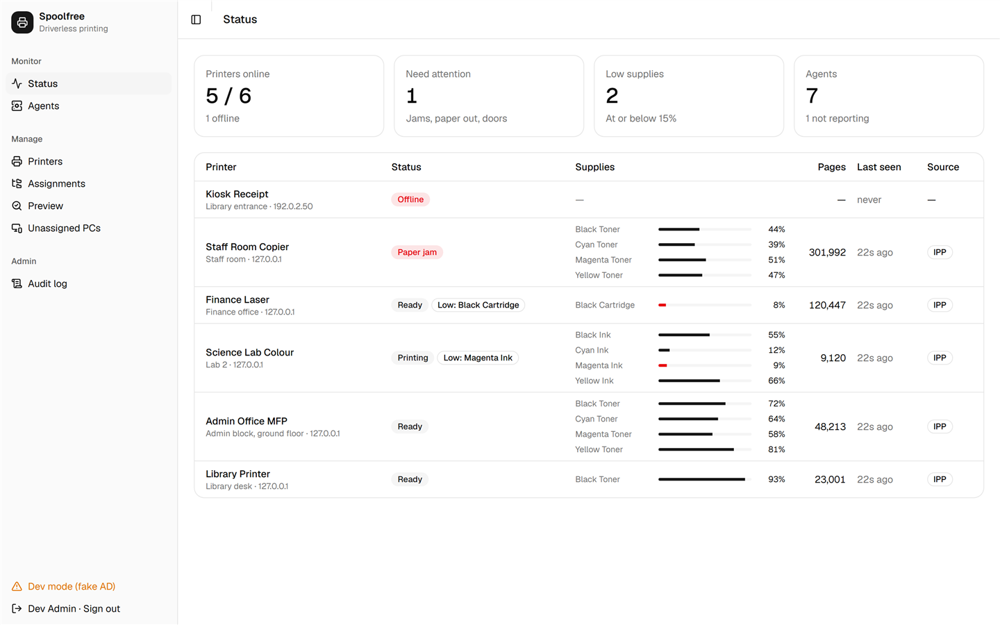
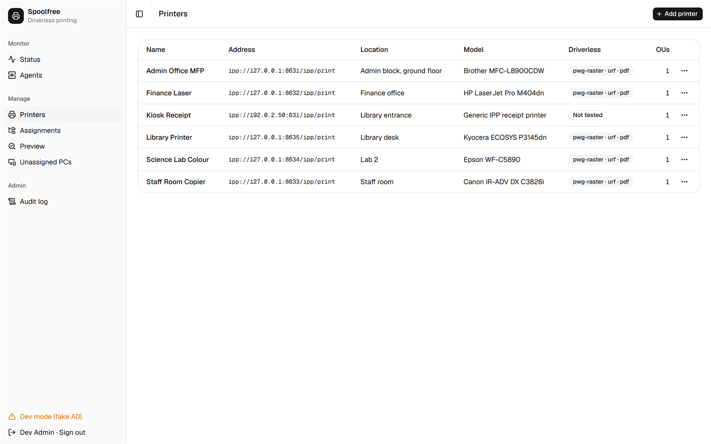
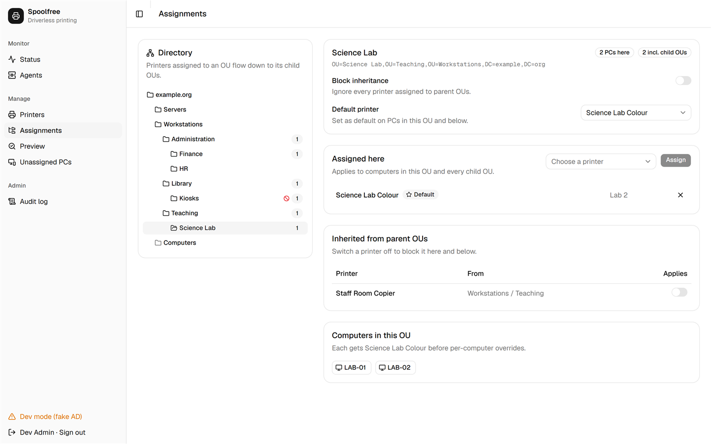
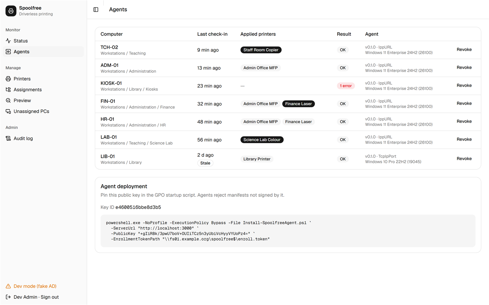
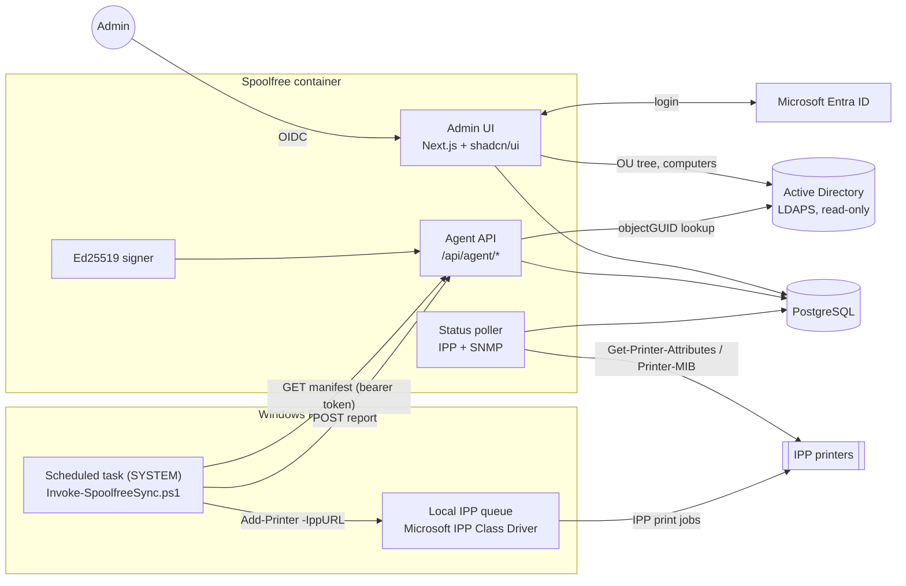

# Spoolfree

**Driverless printing for Windows Active Directory, with no print server and no printer drivers.**

Spoolfree is a self-hosted printer manager for Windows shops that switched off Point-and-Print and print-server spooler RPC after PrintNightmare. Each PC gets a local, machine-wide **driverless IPP queue** that prints straight to the printer through Windows' built-in *Microsoft IPP Class Driver*. You decide which PCs get which printers by **AD OU**. A small PowerShell agent applies a **signed manifest** on each PC.

> Status: v0.1. Usable for pilots. See [Known gaps](#known-gaps).

## The problem

- PrintNightmare (CVE-2021-34527) and the fixes that followed made Point-and-Print driver installs admin-only. Many organisations then disabled the spooler on servers, or blocked RPC to print servers.
- Classic GPO printer deployment needs a print server and vendor drivers on every PC.
- Windows 11 24H2 adds **Windows Protected Print Mode** (WPP), which blocks third-party drivers completely.
- Most printers sold since about 2015 speak **IPP Everywhere / AirPrint / Mopria**. Windows can print to them with no vendor driver.

What has been missing is the management layer: *which PCs get which printer, which one is default, is it out of toner?* Spoolfree provides it.

## Why driverless IPP

| | Print server + vendor drivers | Spoolfree (driverless IPP) |
|---|---|---|
| Drivers on PCs | Vendor V3/V4 drivers | None (inbox Microsoft IPP Class Driver) |
| Spooler RPC to a server | Required | Not used; PCs talk IPP directly to printers |
| Windows Protected Print Mode | Breaks third-party drivers | Supported |
| Single point of failure | Print server | None (the server only hands out policy) |
| Replacing a printer | Re-map queues or re-push GPOs | "Replace" in the UI; PCs re-point at the next sync |

## Features

- **Entra ID (OIDC) login.** Access is limited to members of an admin group (by group object ID).
- **Printers:** add, edit and delete. The **Test** button runs IPP Get-Printer-Attributes to confirm driverless support (`image/pwg-raster`, `image/urf`, `application/pdf`). **Replace** swaps the device behind a logical printer and keeps its name.
- **Assignments by OU** from a read-only LDAP(S) view of AD:
  - inheritance to child OUs;
  - per-OU *block inheritance* or *block this inherited printer*;
  - per-OU default printer;
  - per-computer *add* / *block* overrides.
- **Preview:** "what will computer X get?", with a step-by-step trace and the exact manifest payload.
- **Unassigned PCs:** computers left in the default `CN=Computers` container, and enabled computers whose OU chain gets no printers.
- **Status dashboard:**
  - an in-process poller (default every 2 min) reads each printer over IPP, with SNMP Printer-MIB as a fallback;
  - shows online/offline, toner and ink levels, jams, paper-out, page count and last seen;
  - optional webhook alerts on changes.
- **Agents view:** last check-in, applied printers and errors per PC. You can revoke a PC's token.
- **Audit log** of every admin change.
- **`/metrics`** (Prometheus) and **`/healthz`**.



| Printers | Assignments | Agents |
|---|---|---|
|  |  |  |

*(Screenshots come from the built-in development mode with sample data.)*

## Architecture



1. An admin assigns printers to OUs in the UI.
2. At startup and every hour, each PC's agent calls `GET /api/agent/manifest` with its per-machine token.
3. The server finds the computer by `objectGUID` in AD (so the OU always comes from AD, never from the client). It resolves inheritance, blocks and overrides, and returns a manifest signed with **Ed25519**.
4. The agent checks the signature against the public key pinned at install time. It also checks that the manifest names this computer and has not expired.
5. The agent then creates, re-points or removes the queues it owns, records the default printer, and reports back.

## Quick start (development, no AD or Entra needed)

Requirements: Node.js 22+, pnpm, Docker.

```bash
pnpm install
docker compose up -d postgres          # PostgreSQL on 127.0.0.1:55432
cp .env.example .env
pnpm keygen --env >> .env              # signing key + enrollment token
# in .env set: DEV_FAKE_AD=1, DEV_LOGIN=1 and AUTH_SECRET (any random string)
pnpm seed:dev                          # sample printers, assignments and agents
pnpm dev:printers                      # (separate terminal) simulated IPP printers on 127.0.0.1:8631-8635
pnpm dev                               # http://localhost:3000, then click "Development login"
```

`DEV_FAKE_AD=1` replaces LDAP with a built-in `example.org` directory. `DEV_LOGIN=1` adds a login button that skips Entra ID. **Production builds (`next build`) ignore both flags.**

Checks: `pnpm typecheck`, `pnpm lint`, `pnpm test` (Vitest). Agent tests: `Invoke-Pester agent/tests` (Pester 5+, Windows PowerShell 5.1 or PowerShell 7).

## Production deployment

- **Container:** `docker build -t spoolfree .` gives a single non-root image that serves the UI and API and runs the poller. Migrations run at startup (`MIGRATE_ON_START=1`).
- **Kubernetes:** a generic Helm chart is in [`deploy/helm/spoolfree`](deploy/helm/spoolfree), with an example in [`deploy/values.example.yaml`](deploy/values.example.yaml). Secrets come from an existing Secret that you manage.
- **Configuration:** everything is set through environment variables, all documented in [`.env.example`](.env.example).
- **Multiple replicas:** safe. A Postgres advisory lock makes sure only one replica polls printers at a time.

### 1. Entra ID app registration

1. Register an app (single tenant). Add the redirect URI `https://spoolfree.example.org/api/auth/callback/microsoft-entra-id`.
2. Create a client secret.
3. Under **Token configuration**, add a **groups claim** (Security groups, *Group ID*).
   - For users who belong to many groups, use **"Groups assigned to the application"**. This avoids the 200-group overage, which Spoolfree rejects with a clear message.
4. Set `AUTH_MICROSOFT_ENTRA_ID_ID`, `AUTH_MICROSOFT_ENTRA_ID_SECRET`, `AUTH_MICROSOFT_ENTRA_ID_ISSUER` (`https://login.microsoftonline.com/<tenant-id>/v2.0`) and `ADMIN_GROUP_IDS` (the admin group's object ID).

### 2. Read-only AD account

Create a plain user (for example `svc-spoolfree`). It needs no extra rights: authenticated users can already read OUs and computer objects.
- Use `ldaps://` and point `LDAP_CA_CERT_FILE` at your AD CS root CA (PEM).
- Spoolfree never writes to AD.

### 3. Keys

Run `pnpm keygen` once:
- store `MANIFEST_SIGNING_KEY` and `AGENT_ENROLLMENT_TOKEN` in your secret store;
- keep the printed **public key** for the GPO.

### 4. GPO setup (agent)

1. Copy the files from `agent/` (`Install-SpoolfreeAgent.ps1`, `Invoke-SpoolfreeSync.ps1`, `Set-SpoolfreeUserDefault.ps1`, `Spoolfree.Agent.psm1`) to a share that computers can read, for example `\\example.org\NETLOGON\spoolfree\`.
2. Write the enrollment token to a file on a **restricted** share, for example `\\fs01.example.org\spoolfree$\enroll.token`:
   - share and NTFS permissions: **Domain Computers: Read**, Domain Admins: Full. **Not** Authenticated Users or Domain Users.
   - **Do not use SYSVOL or NETLOGON for the token.** Every user can read those.
3. Create a GPO linked to the OUs that hold your PCs. Under *Computer Configuration → Policies → Windows Settings → Scripts → Startup → PowerShell Scripts*, add:
   - Script: `\\example.org\NETLOGON\spoolfree\Install-SpoolfreeAgent.ps1`
   - Parameters: `-ServerUrl https://spoolfree.example.org -PublicKey <public key> -EnrollmentTokenPath \\fs01.example.org\spoolfree$\enroll.token`
4. Recommended: in the same GPO, set *Computer Configuration → Administrative Templates → System → Logon → "Always wait for the network at computer startup and logon"* = Enabled.
5. Reboot a test PC. Within a few minutes it appears under **Agents**.
   - Sync log: `C:\ProgramData\Spoolfree\Logs\sync.log`.
   - Scheduled tasks: under `\Spoolfree\`.

The installer is idempotent, so leaving it as a startup script is fine. It also updates the agent files when you update the share.

## How the agent creates queues

| Windows | Method | Notes |
|---|---|---|
| Windows 11 (all), Windows 10 builds whose `Add-Printer` has `-IppURL` | `Add-Printer -IppURL http(s)://printer:631/ipp/print` | **Primary.** Windows picks the Microsoft IPP Class Driver from the printer's IPP attributes. Creates a local, machine-wide queue. The only method reported to keep working with **Windows Protected Print Mode** on. The printer must be reachable when the queue is created; the agent retries at the next sync. |
| Older Windows 10 without `-IppURL`, WPP off | `Add-PrinterPort` (Standard TCP/IP) + `Add-Printer -DriverName "Microsoft IPP Class Driver"` | **Fallback.** Not WPP-compatible. Whether the class driver's output prints correctly over a raw TCP port depends on the printer model, so test it first. |
| No `-IppURL` and WPP on | none | Reported as an error. |

The agent checks whether `-IppURL` is available at runtime: `(Get-Command Add-Printer).Parameters.ContainsKey('IppURL')`.

**Which queues it touches.** It only changes queues it created. Each one is recorded under `HKLM:\SOFTWARE\Spoolfree\Printers` and carries a `Managed by Spoolfree [...]` comment.
- A queue with the same name that someone else created is reported as a conflict and left alone.
- A queue whose comment was changed is not deleted.

**Default printer.** Windows keeps the default printer per user. The agent records the policy default, and the *Spoolfree User Default* logon task applies it. That task only acts when the policy value changes, so a user's own choice is kept until then.

## Configuration reference

See [`.env.example`](.env.example). Every setting is an environment variable. For Docker or Kubernetes secrets, the signing key and the enrollment token can also be read from files (`*_FILE`).

## Security

See [SECURITY.md](SECURITY.md) for the threat model: enrollment token, per-machine tokens, manifest signing, and what an attacker can and cannot do.

## Known gaps

- `Add-Printer -IppURL` has been tested as SYSTEM on one Windows 11 25H2 PC (build 26200, WPP off) against an AirPrint printer over plain IPP. The queue gets the Microsoft IPP Class Driver and a port named `WSD-<guid>` (description "IPP Port"), which Windows removes together with the queue. Windows allows only one IPP queue per device, so the agent removes a renamed queue before it adds the new one. Still untested: Windows 10 22H2, WPP on, and IPPS queues (including whether they need the "same security settings for all users" option).
- On laptops in Modern Standby, Task Scheduler holds the sync task as "Queued" until the device wakes, so changes are applied at the next wake rather than on the hour.
- IPPS printers with self-signed certificates may need their certificate trusted on PCs.
- Per-user (rather than per-computer) printer targeting is not supported.
- SNMP is v2c only.
- The webhook payload is a generic JSON body. There are no Teams- or Slack-specific formats yet.
- The enrollment token is a shared secret. Kerberos- or certificate-based machine authentication is on the roadmap (see SECURITY.md).

## Prior art and thanks

**PrintDeployGPO** inspired the signed-manifest approach and the "what will this computer get" preview. Spoolfree is an independent implementation and contains no code from it.

## Licence

MIT © Alee Ibrahim. See [LICENSE](LICENSE).
