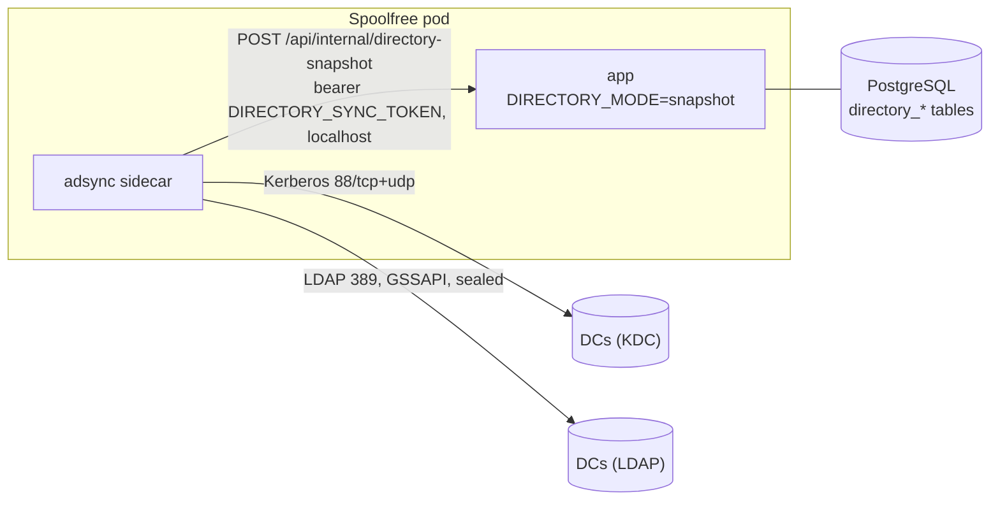

# Production deployment

- **Container:** `docker build -t spoolfree .` gives a single non-root image that serves the UI and API and runs the poller. Migrations run at startup (`MIGRATE_ON_START=1`).
- **Kubernetes:** a generic Helm chart is in [`deploy/helm/spoolfree`](../deploy/helm/spoolfree), with an example in [`deploy/values.example.yaml`](../deploy/values.example.yaml). Secrets come from an existing Secret that you manage.
- **Configuration:** everything is set through environment variables, all documented in [`.env.example`](../.env.example).
- **Multiple replicas:** safe. A Postgres advisory lock makes sure only one replica polls printers at a time.

## 1. Entra ID app registration

1. Register an app (single tenant). Add the redirect URI `https://spoolfree.example.org/api/auth/callback/microsoft-entra-id`.
2. Create a client secret.
3. Under **Token configuration**, add a **groups claim** (Security groups, *Group ID*).
   - For users who belong to many groups, use **"Groups assigned to the application"**. This avoids the 200-group overage, which Spoolfree rejects with a clear message.
4. Set `AUTH_MICROSOFT_ENTRA_ID_ID`, `AUTH_MICROSOFT_ENTRA_ID_SECRET`, `AUTH_MICROSOFT_ENTRA_ID_ISSUER` (`https://login.microsoftonline.com/<tenant-id>/v2.0`) and `ADMIN_GROUP_IDS` (the admin group's object ID).

## 2. Read-only AD account

Create a plain user (for example `svc-spoolfree`). It needs no extra rights: authenticated users can already read OUs and computer objects.

- Use `ldaps://` and point `LDAP_CA_CERT_FILE` at your AD CS root CA (PEM).
- No LDAPS certificate, and the DCs require LDAP signing (a simple bind on 389 fails with `strongerAuthRequired`)? Use the [AD sync sidecar](#ad-sync-sidecar-kerberos).
- Spoolfree never writes to AD.

## 3. Keys

Run `pnpm keygen` once:

- store `MANIFEST_SIGNING_KEY` and `AGENT_ENROLLMENT_TOKEN` in your secret store;
- keep the printed **public key** for the GPO.

## 4. GPO setup (agent)

1. Copy the files from `agent/` (`Install-SpoolfreeAgent.ps1`, `Invoke-SpoolfreeSync.ps1`, `Set-SpoolfreeUserDefault.ps1`, `Spoolfree.Agent.psm1`) to a share that computers can read, for example `\\example.org\NETLOGON\spoolfree\`.
2. Write the enrollment token to a file on a **restricted** share, for example `\\fs01.example.org\spoolfree$\enroll.token`:
   - share and NTFS permissions: **Domain Computers: Read**, Domain Admins: Full. **Not** Authenticated Users or Domain Users.
   - **Do not use SYSVOL or NETLOGON for the token.** Every user can read those.
3. Create a GPO linked to the OUs that hold your PCs. Under *Computer Configuration → Policies → Windows Settings → Scripts → Startup → PowerShell Scripts*, add:
   - Script: `\\example.org\NETLOGON\spoolfree\Install-SpoolfreeAgent.ps1`
   - Parameters: `-ServerUrl https://spoolfree.example.org -PublicKey <public key> -EnrollmentTokenPath \\fs01.example.org\spoolfree$\enroll.token`
4. Recommended: in the same GPO, set *Computer Configuration → Administrative Templates → System → Logon → "Always wait for the network at computer startup and logon"* = Enabled.
5. Reboot a test PC. Within a few minutes it appears under **Agents**.
   - Sync log: `C:\ProgramData\Spoolfree\Logs\sync.log`.
   - Scheduled tasks: under `\Spoolfree\`.

The installer is idempotent, so leaving it as a startup script is fine. It also updates the agent files when you update the share.

## AD sync sidecar (Kerberos)

Optional. For domains where the app cannot bind itself: domain controllers that require LDAP signing (Windows default since the 2023+ hardening) and serve no LDAPS certificate. The sidecar image `ghcr.io/alee-ibrahim/spoolfree-adsync` (source in [`adsync/`](../adsync), Python with python-ldap, MIT Kerberos and Cyrus SASL GSSAPI) binds with **SASL GSSAPI** and a **sealed** connection, which AD accepts on port 389 without a certificate.



**How it works**

1. At startup the sidecar writes a `krb5.conf` (realm, KDCs, AES only, `rdns = false`, `dns_canonicalize_hostname = false`) and builds a keytab from the bind password with `ktutil addent -password ... -f` (`-f` asks the KDC for the salt). The password comes from a mounted file and only travels on ktutil's stdin. Keytab, ticket cache and config live in a memory-backed `/tmp`.
2. Every `ADSYNC_INTERVAL_SECONDS` (default 300) it runs `kinit -k`, binds to the first DC in `ADSYNC_LDAP_URLS` that answers, requires a security strength factor of at least 128, and reads with paged searches:
   - OUs: DN, name, `objectGUID`, description;
   - computers: DN, `objectGUID`, `userAccountControl`, `dNSHostName`, name, operating system;
   - the default computers container (`wellKnownObjects`).
3. It pushes the full snapshot to the app. The app validates it (same base DN as `LDAP_BASE_DN`, no objects outside it, no duplicate GUIDs or DNs, at least one computer) and replaces the `directory_*` tables in one transaction. A failed sync is reported to the app as an error and shown in the UI; the last good snapshot stays in use.
4. The OU tree, computer lists, agent enrollment and every manifest request read the snapshot. A computer must exist, be enabled (`userAccountControl`) and, at enrollment, match the claimed DN and name. A moved PC gets its new OU's printers after the next sync.
5. Freshness: the Assignments and Unassigned pages show "Directory synced N min ago"; every admin page shows a warning when the snapshot is older than `DIRECTORY_STALE_MINUTES` (30) or the last sync failed. Agents are refused with 503 when the snapshot is older than `DIRECTORY_MAX_AGE_HOURS` (24; `0` disables), so a broken sync cannot keep a disabled computer working forever. PCs keep their current queues meanwhile.

The service account is the same plain, read-only user as in section 2. Kerberos needs host names: list DCs by **FQDN, never by IP** (the service principal is `ldap/<fqdn>`; an IP gives `Server not found in Kerberos database`).

**Helm**

```yaml
adsync:
  enabled: true            # also sets DIRECTORY_MODE=snapshot on the app
  ldapUrls: [ldap://dc1.example.org, ldap://dc2.example.org]
  realm: EXAMPLE.ORG
  principal: svc-spoolfree
  passwordSecret: { name: spoolfree-adsync, key: bind_password }      # default: existingSecret / LDAP_BIND_PASSWORD
  tokenSecret:    { name: spoolfree, key: DIRECTORY_SYNC_TOKEN }      # default: existingSecret / DIRECTORY_SYNC_TOKEN
```

Only the sidecar mounts the password; both containers mount the token as a file. Generate the token with 32+ random characters (`openssl rand -base64 33`). Network: the pod needs egress to every DC on 88/tcp, 88/udp and 389/tcp.

**Keep `/api/internal/` off your ingress or gateway.** The app already refuses it without the token (404 outside snapshot mode, 503 if the token is unset or short, 401 on a wrong token), but the sidecar talks to `127.0.0.1` and nothing outside the pod needs the path.

**Sidecar settings** (environment variables; the chart sets them from the values above)

| Variable | Default | Purpose |
|---|---|---|
| `ADSYNC_LDAP_URLS` | | **Required.** `ldap://` URLs by FQDN, space or comma separated, tried in order (failover). |
| `ADSYNC_BASE_DN` | | **Required.** e.g. `DC=example,DC=org`. Must equal the app's `LDAP_BASE_DN`. |
| `ADSYNC_REALM` | | **Required.** Kerberos realm, e.g. `EXAMPLE.ORG`. |
| `ADSYNC_PRINCIPAL` | | **Required.** `svc-spoolfree` or `svc-spoolfree@EXAMPLE.ORG`. |
| `ADSYNC_PASSWORD_FILE` | | **Required.** File holding the account's password (one line). |
| `ADSYNC_TOKEN_FILE` | | **Required** (not for `--dry-run`). File holding `DIRECTORY_SYNC_TOKEN`. |
| `ADSYNC_PUSH_URL` | `http://127.0.0.1:3000/api/internal/directory-snapshot` | Where to push. |
| `ADSYNC_INTERVAL_SECONDS` | `300` | Sync interval (min 30). |
| `ADSYNC_KDCS` | hosts of `ADSYNC_LDAP_URLS` | KDCs for `krb5.conf`. |
| `ADSYNC_ENCTYPES` | `aes256-cts-hmac-sha1-96 aes128-cts-hmac-sha1-96` | Keytab and permitted encryption types. |
| `ADSYNC_KVNO` | `auto` | Key version in the keytab. `auto` reads `msDS-KeyVersionNumber` after the first bind (AD does not check it for the client's own key, so a stale value still works). |
| `ADSYNC_MIN_SSF` | `128` | Minimum SASL security strength factor (sealing). |
| `ADSYNC_PAGE_SIZE` / `ADSYNC_TIMEOUT_SECONDS` | `500` / `30` | Paged search size; network and operation timeout. |
| `ADSYNC_RUNTIME_DIR` | `/tmp/adsync` | krb5.conf, keytab, ticket cache and the `last-success` heartbeat file. |

**Testing:** `--once --dry-run` reads AD and prints counts only (no push, no token needed):

```sh
docker run --rm --read-only --tmpfs /tmp -v /path/to/pw:/run/pw:ro \
  -e ADSYNC_LDAP_URLS=ldap://dc1.example.org -e ADSYNC_BASE_DN=DC=example,DC=org \
  -e ADSYNC_REALM=EXAMPLE.ORG -e ADSYNC_PRINCIPAL=svc-spoolfree -e ADSYNC_PASSWORD_FILE=/run/pw \
  ghcr.io/alee-ibrahim/spoolfree-adsync:0.2.0 --once --dry-run
# {"ous": 9, "computers": 17, "enabled": 16, "disabled": 1, "withDnsHostName": 17, "server": "dc1.example.org", "ssf": 256, "kvno": 2}
```

`--snapshot-file snapshot.json` pushes a JSON file instead of reading AD (development without a domain).

**Password rotation:** change the password in AD and in your secret store, at about the same time. The sidecar re-reads the password file on every cycle and rebuilds the keytab when it changes (and once more after a failed `kinit`); with `ADSYNC_KVNO=auto` it picks up the new key version by itself. Kubernetes refreshes mounted Secret files within about a minute, so no restart is needed; until then a sync may fail and is retried at the next interval.
