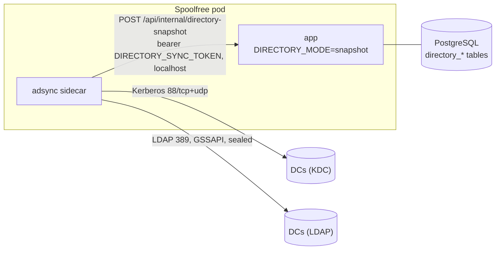

# Production deployment

- **Container:** `docker build -t spoolfree .` gives a single non-root image that serves the UI and API and runs the poller. Migrations run at startup (`MIGRATE_ON_START=1`).
- **Kubernetes:** a generic Helm chart is in [`deploy/helm/spoolfree`](../deploy/helm/spoolfree), with an example in [`deploy/values.example.yaml`](../deploy/values.example.yaml). Secrets come from an existing Secret that you manage.
- **Configuration:** everything is set through environment variables, all documented in [`.env.example`](../.env.example).
- **Multiple replicas:** safe. A Postgres advisory lock makes sure only one replica polls printers at a time.

## 1. Entra ID app registration

1. Register an app (single tenant). Add the redirect URI `https://spoolfree.example.org/api/auth/callback/microsoft-entra-id`.
2. Create a client secret.
3. Under **Token configuration**, add a **groups claim** (Security groups, *Group ID*).
   - For users who belong to many groups, use **"Groups assigned to the application"**. This avoids the 200-group overage, which Spoolfree rejects with a clear message.
4. Set `AUTH_MICROSOFT_ENTRA_ID_ID`, `AUTH_MICROSOFT_ENTRA_ID_SECRET`, `AUTH_MICROSOFT_ENTRA_ID_ISSUER` (`https://login.microsoftonline.com/<tenant-id>/v2.0`) and `ADMIN_GROUP_IDS` (the admin group's object ID).

## 2. Read-only AD account

Create a plain user (for example `svc-spoolfree`). It needs no extra rights: authenticated users can already read OUs and computer objects.

- Use `ldaps://` and point `LDAP_CA_CERT_FILE` at your AD CS root CA (PEM).
- No LDAPS certificate, and the DCs require LDAP signing (a simple bind on 389 fails with `strongerAuthRequired`)? Use the [AD sync sidecar](#ad-sync-sidecar-kerberos).
- Spoolfree never writes to AD.

## 3. Keys

Run `pnpm keygen` once:

- store `MANIFEST_SIGNING_KEY` and `AGENT_ENROLLMENT_TOKEN` in your secret store;
- keep the printed **public key** for the GPO.

## 4. GPO setup (agent)

1. Copy the files from `agent/` (`Install-SpoolfreeAgent.ps1`, `Start-SpoolfreeSync.ps1`, `Invoke-SpoolfreeSync.ps1`, `Set-SpoolfreeUserDefault.ps1`, `Spoolfree.Agent.psm1`) to a share that computers can read, for example `\\example.org\NETLOGON\spoolfree\`.
2. Write the enrollment token to a file on a **restricted** share, for example `\\fs01.example.org\spoolfree$\enroll.token`:
   - share and NTFS permissions: **Domain Computers: Read**, Domain Admins: Full. **Not** Authenticated Users or Domain Users.
   - **Do not use SYSVOL or NETLOGON for the token.** Every user can read those.
3. Create a GPO linked to the OUs that hold your PCs. Under *Computer Configuration → Policies → Windows Settings → Scripts → Startup → PowerShell Scripts*, add:
   - Script: `\\example.org\NETLOGON\spoolfree\Install-SpoolfreeAgent.ps1`
   - Parameters: `-ServerUrl https://spoolfree.example.org -PublicKey <public key> -EnrollmentTokenPath \\fs01.example.org\spoolfree$\enroll.token`
4. Recommended: in the same GPO, set *Computer Configuration → Administrative Templates → System → Logon → "Always wait for the network at computer startup and logon"* = Enabled.
5. Reboot a test PC. Within a few minutes it appears under **Agents**.
   - Sync log: `C:\ProgramData\Spoolfree\Logs\sync.log`.
   - Scheduled tasks: under `\Spoolfree\`.

The installer is idempotent, so leaving it as a startup script is fine. It installs the agent in `%ProgramFiles%\Spoolfree\current` and the launcher `Start-SpoolfreeSync.ps1` next to it.

**Updating agents.** From 0.4.3 agents update themselves from the server (see [agent.md](agent.md#self-update)), so a release only needs the server upgraded. The share still matters for new PCs and for the launcher. The installer installs the share's version when it is newer than the PC's, and never replaces a newer version that the PC installed itself (unless you pass `-Force`). PCs on 0.4.2 or older need the 0.4.3 files on the share and one installer run: the next startup, or the GPO's immediate task again.

## AD sync sidecar (Kerberos)

Optional. For domains where the app cannot bind itself: domain controllers that require LDAP signing (Windows default since the 2023+ hardening) and serve no LDAPS certificate. The sidecar image `ghcr.io/alee-ibrahim/spoolfree-adsync` (source in [`adsync/`](../adsync), Python with python-ldap, MIT Kerberos and Cyrus SASL GSSAPI) binds with **SASL GSSAPI** and a **sealed** connection, which AD accepts on port 389 without a certificate.



**How it works**

1. At startup the sidecar writes a `krb5.conf` (realm, KDCs, AES only, `rdns = false`, `dns_canonicalize_hostname = false`) and builds a keytab from the bind password with `ktutil addent -password ... -f` (`-f` asks the KDC for the salt). The password comes from a mounted file and only travels on ktutil's stdin. Keytab, ticket cache and config live in a memory-backed `/tmp`.
2. Every `ADSYNC_INTERVAL_SECONDS` (default 300) it runs `kinit -k`, binds to the first DC in `ADSYNC_LDAP_URLS` that answers, requires a security strength factor of at least 128, and reads with paged searches:
   - OUs: DN, name, `objectGUID`, description;
   - computers: DN, `objectGUID`, `userAccountControl`, `dNSHostName`, name, operating system;
   - the default computers container (`wellKnownObjects`).
3. It pushes the full snapshot to the app. The app validates it (same base DN as `LDAP_BASE_DN`, no objects outside it, no duplicate GUIDs or DNs, at least one computer) and replaces the `directory_*` tables in one transaction. A failed sync is reported to the app as an error and shown in the UI; the last good snapshot stays in use.
4. The OU tree, computer lists, agent enrollment and every manifest request read the snapshot. A computer must exist, be enabled (`userAccountControl`) and, at enrollment, match the claimed DN and name. A moved PC gets its new OU's printers after the next sync.
5. Freshness: the Assignments and Unassigned pages show "Directory synced N min ago"; every admin page shows a warning when the snapshot is older than `DIRECTORY_STALE_MINUTES` (30) or the last sync failed. Agents are refused with 503 when the snapshot is older than `DIRECTORY_MAX_AGE_HOURS` (24; `0` disables), so a broken sync cannot keep a disabled computer working forever. PCs keep their current queues meanwhile.

The service account is the same plain, read-only user as in section 2. Kerberos needs host names: list DCs by **FQDN, never by IP** (the service principal is `ldap/<fqdn>`; an IP gives `Server not found in Kerberos database`).

**Helm**

```yaml
adsync:
  enabled: true            # also sets DIRECTORY_MODE=snapshot on the app
  ldapUrls: [ldap://dc1.example.org, ldap://dc2.example.org]
  realm: EXAMPLE.ORG
  principal: svc-spoolfree
  passwordSecret: { name: spoolfree-adsync, key: bind_password }      # default: existingSecret / LDAP_BIND_PASSWORD
  tokenSecret:    { name: spoolfree, key: DIRECTORY_SYNC_TOKEN }      # default: existingSecret / DIRECTORY_SYNC_TOKEN
```

Only the sidecar mounts the password; both containers mount the token as a file. Generate the token with 32+ random characters (`openssl rand -base64 33`). Network: the pod needs egress to every DC on 88/tcp, 88/udp and 389/tcp.

**Keep `/api/internal/` off your ingress or gateway.** The app already refuses it without the token (404 outside snapshot mode, 503 if the token is unset or short, 401 on a wrong token), but the sidecar talks to `127.0.0.1` and nothing outside the pod needs the path.

**Sidecar settings** (environment variables; the chart sets them from the values above)

| Variable | Default | Purpose |
|---|---|---|
| `ADSYNC_LDAP_URLS` | | **Required.** `ldap://` URLs by FQDN, space or comma separated, tried in order (failover). |
| `ADSYNC_BASE_DN` | | **Required.** e.g. `DC=example,DC=org`. Must equal the app's `LDAP_BASE_DN`. |
| `ADSYNC_REALM` | | **Required.** Kerberos realm, e.g. `EXAMPLE.ORG`. |
| `ADSYNC_PRINCIPAL` | | **Required.** `svc-spoolfree` or `svc-spoolfree@EXAMPLE.ORG`. |
| `ADSYNC_PASSWORD_FILE` | | **Required.** File holding the account's password (one line). |
| `ADSYNC_TOKEN_FILE` | | **Required** (not for `--dry-run`). File holding `DIRECTORY_SYNC_TOKEN`. |
| `ADSYNC_PUSH_URL` | `http://127.0.0.1:3000/api/internal/directory-snapshot` | Where to push. |
| `ADSYNC_INTERVAL_SECONDS` | `300` | Sync interval (min 30). |
| `ADSYNC_KDCS` | hosts of `ADSYNC_LDAP_URLS` | KDCs for `krb5.conf`. |
| `ADSYNC_ENCTYPES` | `aes256-cts-hmac-sha1-96 aes128-cts-hmac-sha1-96` | Keytab and permitted encryption types. |
| `ADSYNC_KVNO` | `auto` | Key version in the keytab. `auto` reads `msDS-KeyVersionNumber` after the first bind (AD does not check it for the client's own key, so a stale value still works). |
| `ADSYNC_MIN_SSF` | `128` | Minimum SASL security strength factor (sealing). |
| `ADSYNC_PAGE_SIZE` / `ADSYNC_TIMEOUT_SECONDS` | `500` / `30` | Paged search size; network and operation timeout. |
| `ADSYNC_RUNTIME_DIR` | `/tmp/adsync` | krb5.conf, keytab, ticket cache and the `last-success` heartbeat file. |

**Testing:** `--once --dry-run` reads AD and prints counts only (no push, no token needed):

```sh
docker run --rm --read-only --tmpfs /tmp -v /path/to/pw:/run/pw:ro \
  -e ADSYNC_LDAP_URLS=ldap://dc1.example.org -e ADSYNC_BASE_DN=DC=example,DC=org \
  -e ADSYNC_REALM=EXAMPLE.ORG -e ADSYNC_PRINCIPAL=svc-spoolfree -e ADSYNC_PASSWORD_FILE=/run/pw \
  ghcr.io/alee-ibrahim/spoolfree-adsync:0.4.0 --once --dry-run
# {"ous": 9, "computers": 17, "enabled": 16, "disabled": 1, "withDnsHostName": 17, "server": "dc1.example.org", "ssf": 256, "kvno": 2}
```

`--snapshot-file snapshot.json` pushes a JSON file instead of reading AD (development without a domain).

**Password rotation:** change the password in AD and in your secret store, at about the same time. The sidecar re-reads the password file on every cycle and rebuilds the keytab when it changes (and once more after a failed `kinit`); with `ADSYNC_KVNO=auto` it picks up the new key version by itself. Kubernetes refreshes mounted Secret files within about a minute, so no restart is needed; until then a sync may fail and is retried at the next interval.

## Bulk import and export

`spoolfree-cli printers` creates or updates printers, OU assignments, OU default printers and (YAML only) per-computer
overrides from a YAML or CSV file. It is idempotent: printers are matched by name (case-insensitive), only changed
fields are written, and running the same file twice changes nothing. Every change is in the audit log with actor `cli`. A host/port/path/TLS change bumps the
printer's revision, so PCs re-create the queue.

```yaml
printers:
  - name: Staff Room Copier          # queue name on PCs
    ip: 192.0.2.10                   # or host: copier.example.org; port 631 and useTls false by default
    # ippPath: /ipp                   # omit (or "auto") to let Test detect it; a path is a manual override
    location: Block A
    model: Brother MFC-L8900CDW
    notes: Toner in the store room
    defaultSides: two-sided-long-edge   # auto | one-sided | two-sided-long-edge | two-sided-short-edge
    legacyTakeover: dry-run             # off | dry-run | on (docs/agent.md, "Legacy queue takeover")
    legacyShares: [StaffRoom]           # share names on LEGACY_PRINT_SERVERS
    legacyAliases: [OLD-COPIER-NAME]    # old host names TCP/IP ports may still use (not in DNS); .local optional
    assignments: ["OU=Administration,OU=Workstations,DC=example,DC=org"]
    defaultFor: ["OU=Administration,OU=Workstations,DC=example,DC=org"]

computers:                            # per-computer overrides (YAML only)
  - name: LAB-PC7                     # computer name, or dn: "CN=LAB-PC7,OU=Lab,DC=example,DC=org"
    add: [Staff Room Copier]          # printers added to this computer on top of its OU's
    block: [Lab Printer]              # inherited printers removed from this computer
    default: Staff Room Copier        # optional: this computer's default (added if not in add)
```

`computers:` entries are looked up in the directory (in snapshot mode, the last AD snapshot): by `dn`, or by `name`
(case-insensitive; a name that several computers share is refused, use `dn`). Giving both checks that they agree.
Printer names must exist or be created by the same file. Unknown computers or printers stop the import before
anything is written. `export` writes the overrides back as `computers:` (by computer name).

CSV uses the columns `name,host` (or `ip`)`,port,ipp_path,tls,location,model,notes,duplex,takeover,shares,aliases,assignments,default_for`
(`ipp_path` empty or `auto` = detected);
lists are separated by `;` and DNs must be quoted (they contain commas). `export --format csv` writes this layout.

Options: `--dry-run` prints the plan and writes nothing; `--prune-assignments` also removes assignments of the listed
printers that are not in the file (otherwise assignments are only added); `--prune-overrides` also removes overrides of
the listed computers that the file does not mention (other computers' overrides are never touched); `--format yaml|csv`
(default: by file extension); `-` reads the file from stdin. CSV files carry printers only and never change overrides.

In the container image the CLI is one bundled file (no tsx or `scripts/` needed), using the pod's `DATABASE_URL`:

```sh
kubectl exec -i -n spoolfree deploy/spoolfree -c spoolfree -- node cli/spoolfree-cli.mjs printers import - --dry-run < printers.yaml
kubectl exec -i -n spoolfree deploy/spoolfree -c spoolfree -- node cli/spoolfree-cli.mjs printers import - < printers.yaml
kubectl exec -n spoolfree deploy/spoolfree -c spoolfree -- node cli/spoolfree-cli.mjs printers export > printers.yaml
```

From a checkout: `npx tsx scripts/printers.ts import printers.yaml --dry-run` (`DATABASE_URL` from the environment).
The same bundle has the break-glass account commands: `node cli/spoolfree-cli.mjs local-user add <name>` with the
password on stdin (docs/admin-access.md).

### Deleting and renaming printers

```sh
kubectl exec -n spoolfree deploy/spoolfree -c spoolfree -- node cli/spoolfree-cli.mjs printers delete "Old Copier" --dry-run
kubectl exec -n spoolfree deploy/spoolfree -c spoolfree -- node cli/spoolfree-cli.mjs printers delete "Old Copier"
kubectl exec -n spoolfree deploy/spoolfree -c spoolfree -- node cli/spoolfree-cli.mjs printers rename "Old Name" "New Name" --dry-run
kubectl exec -n spoolfree deploy/spoolfree -c spoolfree -- node cli/spoolfree-cli.mjs printers rename "Old Name" "New Name"
```

These run the same code as **Delete** and renaming a printer in the UI. Names match case-insensitively; quote names
that contain spaces.

- `printers delete <name> [--dry-run]` deletes the printer with its OU assignments, the OU defaults and OU blocks that
  name it, and the per-computer overrides that reference it, in one transaction. Agents remove the managed queue at
  their next sync (the printer is no longer in their manifest). Queues that someone changed so they no longer carry the
  Spoolfree comment are left alone.
- `printers rename <old-name> <new-name> [--dry-run]` changes only the name. The id stays, so assignments, defaults,
  overrides, status and print history stay with the printer. At their next sync agents remove the old queue and add it
  under the new name; users' default printer follows at their next logon
  ([agent.md](agent.md#default-printer-after-a-rename-or-replace)). A change of case only is allowed.

`--dry-run` prints what would change and writes nothing. Both write one audit row with actor `cli` (`printer.delete`
with what was removed, or `printer.update` with the old and new name). An unknown name, a new name that another printer
already has, or an invalid name (empty, over 100 characters, or containing `\ / , !`) exits with status 1 and changes
nothing; wrong arguments print the usage and exit with status 2. `printers --help` prints the usage.

### Driver settings and testing from the CLI

Bulk files also carry the driver settings (0.7):

- `driverMode`: `auto` (the default), `driverless` or `vendor`;
- `driverPackage` (the package name) and `driverName`, for vendor mode;
- `protocol` (`raw9100`, `lpr` or `ipp`) and `lprQueue`.

In CSV the columns are `driver_mode`, `driver_package`, `driver_name`, `protocol` and `lpr_queue`. Packages are
uploaded with `drivers upload` ([docs/drivers.md](drivers.md#driver-packages)).

`printers test [<name> ...]` runs the same IPP Test as the admin UI. With no names it tests every printer. It records
what auto driver mode needs; `drivers decide` then shows the driver each printer gets.

```sh
kubectl exec -n <ns> deploy/spoolfree -c spoolfree -- node cli/spoolfree-cli.mjs printers test "8F Bureau Brother HL-3150CDN"
kubectl exec -n <ns> deploy/spoolfree -c spoolfree -- node cli/spoolfree-cli.mjs drivers decide
```

## Migrating from a print server

1. List the old servers in `LEGACY_PRINT_SERVERS` (FQDN and/or short name, comma-separated).
2. Import the printers with their old share names (`legacyShares`) and `legacyTakeover: dry-run`.
3. After a sync, **Agents** shows "Would remove …" per PC (machine queues at the next sync, per-user `\\server\share`
   connections after the user's next logon). Check that only the expected queues are listed.
4. Switch the printers to `on` (UI: **Advanced (migration)** in the printer form, or re-import). Agents remove the old queues, create the Spoolfree queue and, for users
   whose default was a removed queue, make the Spoolfree queue their default at their next logon.
